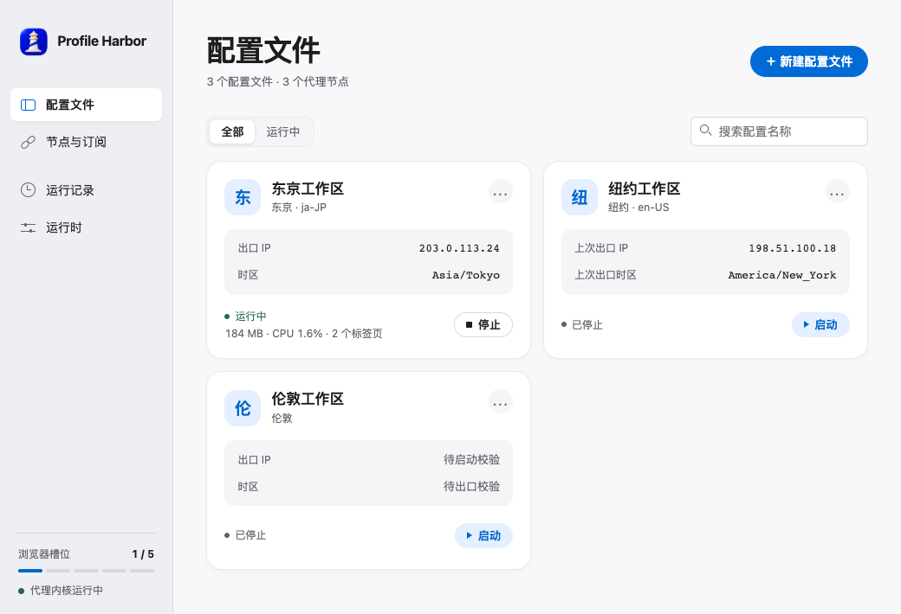

<p align="center"></p>
<h1 align="center">Profile Harbor</h1>
<p align="center">Manage up to five Chrome profiles on your Mac and see the exit IP and time zone for each one.</p>
<p align="center">
  
  
  <a href="https://github.com/ProvenceJake/profile-sandbox-browser/releases/tag/v0.11.1"></a>
</p>
<p align="center"><strong>English</strong> · <a href="README.zh-CN.md">简体中文</a></p>
<p align="center"><a href="https://github.com/ProvenceJake/profile-sandbox-browser/releases/download/v0.11.1/Profile-Harbor-0.11.1-mac-arm64.zip"><strong>Download for macOS</strong></a> · <a href="https://github.com/ProvenceJake/profile-sandbox-browser/releases">Releases</a> · <a href="https://github.com/ProvenceJake/profile-sandbox-browser/issues">Report an issue</a></p>

---

Each profile has its own Chrome process, data directory, and proxy connection. When you stop a profile, its last verified exit IP stays visible in the list.

The manager is built with Rust and Tauri 2. Its local WebView interface is in Simplified Chinese. The steps below include the labels you’ll see in the app.



## Install

Requires macOS 15 or later on Apple Silicon. Download the ZIP from the [macOS prerelease](https://github.com/ProvenceJake/profile-sandbox-browser/releases/tag/v0.11.1), extract it, and open **Profile Harbor.app**. The current build uses an ad hoc signature. Developer ID signing and Apple notarization are pending.

## Use a profile

1. Open **Nodes & subscriptions (节点与订阅)**. Add an HTTP or SOCKS5 proxy, import a Clash/Mihomo YAML configuration with a `proxies` list, or enter a subscription URL. YAML imports also support individual nodes using other supported protocols. When you refresh a source, the app matches its nodes by name.
2. In **Profiles (配置文件)**, create a profile and select its node. Automatic mode downloads the DB-IP offline city database on first use and derives the local settings from the exit IP. Manual mode lets you select a language and city time zone, preview the local time, or enter a language tag, time zone, and coordinates. Chrome uses the Mac’s clock and displays local time in the profile’s time zone.
3. Click **Start (启动)**. The manager verifies the exit through the selected node, then checks the exit and request language from Chrome. It also checks the time zone, preferred language, and default formatting locale in a page and a worker. The browser’s start page shows the profile name, language, time zone, and local time. Chrome uses the corresponding interface language when available. Websites still need your permission to access geolocation.
4. On the profile list, check the exit IP and time zone. A new automatic profile shows a pending value until its first check. Use **More actions (更多操作)** to switch nodes. Switching closes the profile’s existing connections. If the exit region changes, you can apply the new settings, keep the previous ones, or cancel. Applying a new time zone or language restarts that browser.
5. Close the manager window and reopen it from the menu bar, or use the menu bar to stop all profiles and quit. **Activity (运行记录)** shows events, startup times, median and 95th-percentile startup latency, and resource samples by profile.

## Storage and isolation

- **Chrome runtime.** The manager uses the installed Google Chrome by default. Under **Runtime (运行时)** you can download the pinned official Chrome build or switch back to the system installation. The manager verifies the download’s SHA-256 digest, checks Google’s signature before launch, and guards against version downgrades.
- **Profile data.** Duplicating a profile creates an empty browser workspace with the same node and regional settings. Removed profiles go to the recycle directory. Restore or purge them under Runtime. The manager periodically removes entries that have spent seven days there.
- **Credentials and diagnostics.** Subscription URLs and node configurations are stored in macOS Keychain. Metadata and resource samples are stored in SQLite in the app’s data directory. Samples are retained for 30 days. Mihomo’s temporary provider files are removed when the proxy core shuts down.
- **Connections and cleanup.** Each running profile has its own loopback proxy entry point. The manager closes existing connections when the proxy stops or the exit is rechecked. The WebView is released when its window closes, and the proxy core shuts down five minutes after the last profile stops. If the manager crashes, Chrome’s control pipe and a native guard handle browser and proxy shutdown.
- **Host resources.** Profiles share the Mac’s system fonts and clock. macOS grants camera and microphone permissions to the Chrome application bundle. The loopback proxy ports accept connections from local processes without authentication. See the [desktop validation notes (Chinese)](docs/desktop-0.9.md) for the network tests and their scope.

## Build and test

On an Apple Silicon Mac with Xcode Command Line Tools and stable Rust, run the following from the repository root. The packaging script downloads the official Mihomo archive, verifies its pinned digest, and writes the app bundle and release ZIP to `dist/`.

```sh
scripts/package.sh
```

The local integration tests require Node.js 22 or later, an available login keychain, and an installed copy of Google Chrome. They use temporary profiles, databases, and proxy fixtures. After packaging, run both test suites from the repository root.

```sh
HARBOR_TEST_ENGINE="$PWD/dist/Profile Harbor.app/Contents/MacOS/mihomo" node tests/desktop.mjs
MIHOMO_BIN="$PWD/dist/Profile Harbor.app/Contents/MacOS/mihomo" node probes/m0.mjs
```

For a signed and notarized release, the packaging script accepts `MACOS_SIGN_IDENTITY` for the Developer ID identity and `NOTARY_PROFILE` for the notarytool credentials profile. Build files in `.build/` and packages in `dist/` are excluded from Git.

[Third-party components and data](resources/licenses/Attribution.txt) · [Design plan (Chinese)](docs/plan-v1.md) · [Initial isolation tests (Chinese)](docs/m0.md) · [Desktop validation notes (Chinese)](docs/desktop-0.9.md)
